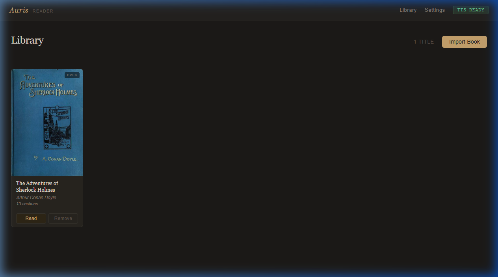
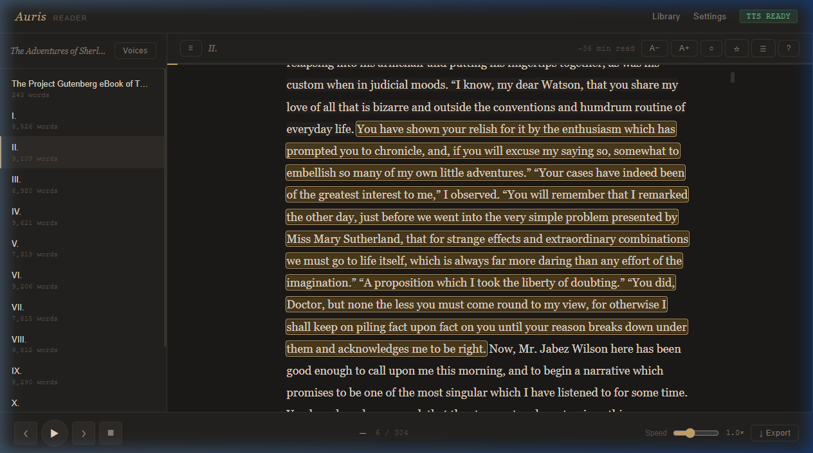
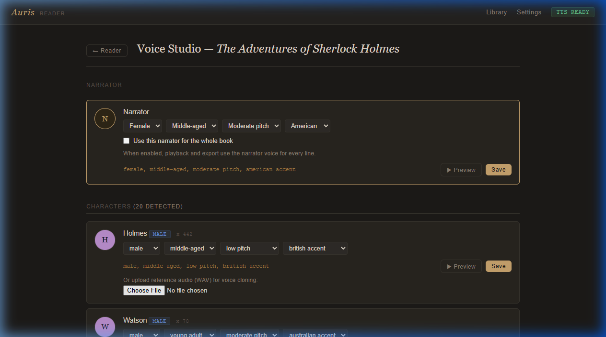
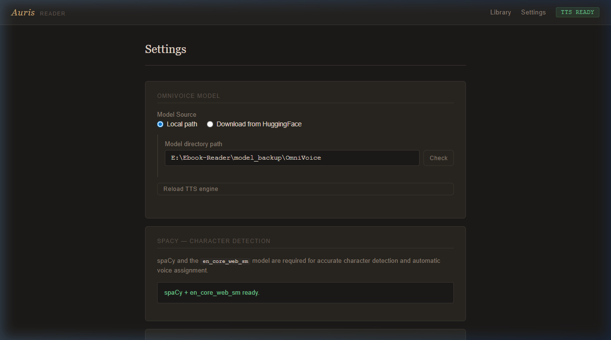

# Auris

[](https://github.com/gaiagent0/Auris/releases/latest)

Az Auris [eredeti projektjének](https://github.com/nikhilprasanth/Auris) magyar
nyelvű forkja, **Snapdragon X Elite / Windows 11 ARM64-nál optimalizálva**.
Magyar felülettel és súgóval, helyben futó hangoskönyv-olvasóval.

This is the Hungarian-language fork of the [original Auris project](https://github.com/nikhilprasanth/Auris), **optimized and measured for Snapdragon X Elite / Windows 11 ARM64**.

Current version: [`VERSION`](VERSION). See the complete bilingual
[`CHANGELOG.md`](CHANGELOG.md) and the [`RELEASING.md`](RELEASING.md) guide for
the versioning and release process.

Local-first audiobook reader for EPUB, PDF, DOCX, TXT, PRC/MOBI, and public web articles with four selectable local
speech engines (Supertonic 3, Supertonic 3 sherpa-onnx int8, XTTSv2-ONNX voice cloning and Piper — all ONNX Runtime on the CPU), Hungarian-first text
processing, character-aware voices, per-book narrator control, and duration-based estimated word highlighting.

Reading, speech generation, playback, and file import run locally after setup,
with no hosted TTS dependency. Web-article import requires a network connection.
Character analysis can use a local OpenAI-compatible server without a key, or
the optional OpenAI API with a separately billed API key.

## Snapdragon X Elite / Windows 11 ARM64 — optimalizálás és mérés

Ez a fork a **Snapdragon X Elite (ARM64) rendszeren valósan mért és optimalizálva**.
A natív ARM64 futás minden másik platformot előze, a mérési bizonyíték a
[`docs/meresek.md`](docs/meresek.md) (M-01…M-45) bejegyzésekkel.

| Elem | Érték (mérve) |
|---|---|
| Gép | Windows 11 ARM64, Snapdragon X Elite, 12 mag, 31,6 GB RAM |
| Python | 3.12.10 natív ARM64 (nem x86_64 emuláció) |
| ONNX Runtime | 1.30.0 |
| Alapmotor | Supertonic 3, `supertonic_batch=4` → **2,25×** gyorsabb |
| Sherpa-onnx Supertonic int8 | **RTF 0,140** = 428 perc hang/óra = az Auris serial 5,4×, batch 2,4× gyorsabb · WER 0,11 % |
| Klónozó | XTTSv2-Streaming-ONNX (magyar) — int8 1,32× valós idő, WER 0,18 % |
| Magyar ASR (QA) | Parakeet TDT v3 (`nemo-parakeet-tdt-0.6b-v3` → `istupakov/parakeet-tdt-0.6b-v3-onnx`, CC-BY-4.0) |

Kiegészítések ebben a fork-ban:
- **Batchelt Supertonic-generálás** — a `generate_many` azonos hang/nyelv/tempó
  mondatokot csoportosít (2,25× gyorsabb, `supertonic_batch` 1..6).
- **Sherpa-onnx Supertonic 3 int8 — FIRST-CLASS motor** (`reader/core/supertonic_sherpa_engine.py`):
  beillesztett a motor-választóba (`supertonic_sherpa`), a Snapdragon-ra a
  **leggyorsabb** (`auto`-javaslat), `sherpa-onnx` a deps-ben, a modell
  **automatikusan letölti** a HF-en `reader/models/supertonic-sherpa-int8/`-re
  (~139 MB) az első futásnál. RtF 0,140, 44,1 kHz, beépített hangokon (nem klónoz).
- **Silero VAD** a QA-elemzésben (`reader/core/qa.py` `vad_speech_spans`).
- **Magyar WER/CER-ellenőrzés** a 24 mondatos korpuszon (`core/hu_wer.py`),
  magyar kiejtési szótárral.

### Friss-klón Snapdragon runbook (a leggyorsabb út)

```powershell
cd /d "%USERPROFILE%"
git clone https://github.com/gaiagent0/Auris.git
cd Auris
reader\setup.bat          # ARM64-nál a natív venv + minden függőség (sherpa-onnx is)
reader\run.bat            # http://127.0.0.1:7860
```

- A `setup.bat` a Snapdragon-ra a **natív ARM64 Python 3.12**, ONNX Runtime 1.30
  és `sherpa-onnx` (win_arm64 wheel) telepíti; a Supertonic + sherpa-Supertonic
  modellok letöltik az első betöltéssel.
- A leggyorsabb motor a javasolt (`auto` → `supertonic_sherpa`); a Beállításokban
  `tts_engine=supertonic_sherpa`-ra állíthatd, ha explicit jelöltet akarod.
- **A natív venv az elsődleges út Windowson**: nincs konténer-réteg, és a
  modellek a `reader/models/` alatt maradnak. A Docker (`docker compose up -d
  --build`) **CPU-ra fut** (nem kell NVIDIA) és ott is működik, ahol a natív
  telepítés nem érhető el (pl. x64 Linux szerver) — lásd
  [`docs/docker-wsl.md`](docs/docker-wsl.md).

A használati útmutató: [`docs/HASZNÁLATI-ÚTMUTATÓ.md`](docs/HASZNÁLATI-ÚTMUTATÓ.md).
Az infografika: [`docs/auris-infografika.html`](docs/auris-infografika.html).
A teljes ARM64-telepítés és mérési útmutató: [`reader/docs/arm64-install.md`](reader/docs/arm64-install.md).

## Screenshots

These images show the earlier layout. The current interface uses Hungarian
labels and the updated workflows described below and in the built-in help.

### Library


### Reader


### Voice Studio


### Settings


## Highlights

- Four local speech engines, all running on ONNX Runtime on the CPU: Supertonic 3
  and Supertonic 3 sherpa-onnx int8 (preset Hungarian voices), XTTSv2-ONNX int8
  (voice cloning from a reference recording) and Piper (preset Hungarian
  voices). Settings shows each engine's capabilities and Voice Studio adapts to
  them. The sherpa-onnx Supertonic is the measured-fastest (RTF 0.14) and the
  default `auto` recommendation; the cloning engine appears whenever its text
  pipeline (librosa, pypinyin) is installed.
- Hungarian text processing: dates, Roman numerals, times, units, currencies,
  abbreviations and acronyms are spoken correctly; Hungarian sentence splitting,
  dialogue dashes and quotes; HuSpaCy-based character detection.
- A Production page per book: pipeline status, per-chapter audio and quality
  results, cast overview, whole-book generation and one-click exports.
- Quality control with Whisper speech recognition, alternative takes, approval,
  loudness checks and measured word timings for highlighting.
- Publishing packages: EPUB3 read-along, Audiobookshelf folder/upload,
  distribution MP3 with sample, DAW stems; Opus/FLAC; credits and background music.
- Reference clean-up for voice cloning, takes in another saved voice, and
  per-sentence sound effects.
- Installable, phone-friendly interface with offline playback of cached audio,
  live updates over one server-event stream, a chapter timeline and keyboard
  shortcuts (J/L seek, [ ] speed).

- Preview and import EPUB, PDF, DOCX, TXT, DRM-free PRC/MOBI, or a public HTTP(S) article; edit title,
  author, and language before confirming.
- Split DOCX books by Word heading styles when the document provides them.
- Extract web articles with Trafilatura. Auris does not run page JavaScript and
  blocks localhost, private-network, oversized, and excessive-redirect URLs.
- Detect duplicate source content with SHA-256 while keeping same-named uploads
  in distinct managed files.
- Detect chapters, prologues, epilogues, forewords, appendices, and parts automatically.
- Generate per-character voices with deterministic assignment.
- Attribute dialogue to characters with OpenAI or a configurable local LM
  Studio, Ollama, llama.cpp, or other OpenAI-compatible endpoint.
- Customize each detected character in Voice Studio.
- Customize the narrator voice per book.
- Save reusable narrator/character voice profiles with durable reference audio;
  transfer profiles between Auris installations as `.aurisvoice` files.
- Apply global or per-book pronunciation rules without changing displayed text.
- Preview voices with your own Hungarian sample text and save the result as WAV.
- Upload reference WAV files for voice cloning.
- Invalidate stale cached playback automatically when narrator or character voices change.
- Search within a book, jump 15 seconds, use a sleep timer, and control playback
  through Media Session where the browser supports it.
- Track generation, export, and reanalysis on the durable Jobs page; cancelled or
  restart-interrupted work resumes only when requested and reuses valid cached audio.
- Export numbered, per-chapter audio as WAV or MP3, or one chaptered M4B;
  subtitles can be ASS, SRT, or omitted.
- Select all chapters or use print-style selections such as `1,3,5-8`.
- Save and restore the library as an Auris ZIP, optionally including the
  regenerable audio cache. Restore replaces the library after confirmation and
  first writes a recovery backup; stale jobs from the replaced library are cleared.
- Inspect generated audio-cache usage and remove old files that no book references.
- Run from a project-local `.venv` created by the installer.

## Windows ARM64 alkalmazás / desktop application

Az Auris **Snapdragon X Elite / Windows 11 ARM64** rendszerre készült asztali
alkalmazás: saját ablakban nyílik meg, első indításkor magyar beállítófelület
kínálja a **Supertonic 3** (gyors indulás, modellletöltés) vagy a **XTTSv2-ONNX**
(klónozó, a telepítéssel együtt érkezik) motort. Az első modellletöltéshez
internet kell; a felolvasás ezután teljesen helyben fut.

A könyvek és modellek a `%LOCALAPPDATA%\Auris` mappában (vagy az
`AURIS_DATA_DIR` környezeti változóval megadott helyen) maradnak meg frissítés
után is. [Telepítés, frissítés és hibaelhárítás](docs/windows-desktop.md).

The desktop build targets Windows 11 ARM64 (Snapdragon X Elite). First-run
setup offers the fast Supertonic 3 engine or the bundled XTTSv2-ONNX cloning
engine; everything runs locally on the CPU afterwards. User data and downloaded
models survive application updates. The source-based web installation remains
available below.

## Requirements (source-based web installation)

- Windows 11 ARM64 (Snapdragon X Elite) or Linux ARM64/x64
- Python 3.12 or later
- `ffmpeg` on `PATH` for MP3, M4B, and export mastering
- `onnxruntime` (the engines are CPU-only ONNX models; no GPU required)

## Installation

```bash
git clone https://github.com/gaiagent0/Auris.git
cd Auris
```

Run the installer:

```bash
# Windows
reader\setup.bat

# Linux / macOS
bash reader/setup.sh
```

Or directly:

```bash
python reader/setup.py
```

The installer creates `reader/.venv`, installs the ONNX engine set (Supertonic 3, sherpa-onnx, XTTSv2-ONNX pipeline, Piper), optional CPU PyTorch for the Whisper QA backend, spaCy, and the reader dependencies, then downloads the Hungarian spaCy model when network access is available.

Two packages have no Windows ARM64 wheel, so the installer skips or pins them
there: `pymupdf` is pinned to `1.28.2` (the last release with a win_arm64
wheel), and spaCy/thinc are skipped because their compiled backend (`blis`)
has no win_arm64 build. The app runs without spaCy — character detection falls
back to its rule-based mode — and every other import format stays available.

## Start after installation

When the installer prints **Setup Complete**, start Auris from the cloned
project directory:

```powershell
# Windows
reader\run.bat
```

Alternatively, start it directly from the `reader` directory:

```powershell
cd reader
.\.venv\Scripts\python.exe app.py
```

On Linux or macOS:

```bash
bash reader/run.sh
```

Leave the terminal open while Auris is running, then open
[http://127.0.0.1:7860](http://127.0.0.1:7860) in a browser. Stop the server
with `Ctrl+C` in that terminal.

## Command line, API and Docker

- `reader/auris_cli.py`: batch import, quality check and export from the
  command line (`python auris_cli.py --help`).
- OpenAI-compatible `POST /v1/audio/speech` for other tools, using the active
  engine and saved Hungarian voice profiles.
- `docker compose up -d --build` builds and runs Auris as a **CPU image**
  (works anywhere, including Snapdragon ARM64); data lives in `docker-data/`.
  Docker is the portable alternative to the native venv — on the Snapdragon the
  native install is faster, because the ONNX engines run without a container
  layer. The Windows/WSL details, the model volume wiring and the repair steps
  for a stuck Docker Engine are in
  [`docs/docker-wsl.md`](docs/docker-wsl.md).

## Model setup

Every engine runs locally through ONNX Runtime; there is no hosted dependency.

- **Supertonic 3** — downloaded automatically from Hugging Face on first use
  (`supertone-oss-archive/supertonic-3`, OpenRAIL-M license).
- **Supertonic 3 sherpa-onnx int8** — downloaded automatically on first use
  (~139 MB); the measured-fastest engine on Snapdragon.
- **XTTSv2-ONNX** — the cloning engine ships with the install; the setup wizard
  verifies `vendor/XTTSv2-Streaming-ONNX/xtts_onnx` is present. Cloning needs a
  reference recording uploaded in Voice Studio. XTTSv2 weights follow the Coqui
  Public Model License (non-commercial); review the
  [model card](https://huggingface.co/coqui/XTTS-v2) before use.
- **Piper** — preset Hungarian voices; the `piper-tts` package can be installed
  from Settings.

### Model path overrides

The engines look for their models next to the application, so a fresh clone
works without any configuration. If the models live in a shared hub on your
machine, point the engines at it with these environment variables:

| Variable | Model |
|---|---|
| `VOICEAI_SHERPA_SUPERTONIC` | Sherpa-onnx Supertonic 3 int8 (default: `reader/models/supertonic-sherpa-int8/`, auto-downloaded from Hugging Face) |
| `VOICEAI_XTTS_DIR` | XTTSv2-Streaming-ONNX (the 2,1 GB cloning model) |
| `VOICEAI_SILERO_VAD` | Silero VAD ONNX for the quality-control voice activity detection |

## Usage

1. Choose a file or public article URL on the library page, review the preview,
   then confirm the metadata and narration mode.
2. Open the book and start playback from any sentence.
3. Open Voice Studio from the reader sidebar.
4. Adjust character voices or the narrator voice, preview them, then save.
5. Export the current chapter or select chapters with `all`, a range such as
   `2-6`, or a comma-separated expression such as `1,3,7-10`. Choose WAV, MP3,
   or chaptered M4B and optionally ASS/SRT subtitles.

Scanned PDFs and images can use optional local Tesseract OCR from the library's
import options, with an explicit recognition language (Hungarian: `hun`). Install
Tesseract and the required language data separately. Native PDF text is retained;
only pages without text are recognized. Optional Calibre `ebook-convert` adds
AZW/AZW3, FB2, RTF, ODT, HTML, DOC and LRF import. Both tools are detected on PATH
and in their standard Windows Program Files folders. Empty documents are rejected.

The built-in Hungarian help, **OCR és Calibre → Windows: telepítés lépésről
lépésre**, includes Windows installation commands, Hungarian language data,
PATH setup, verification commands, restart instructions and troubleshooting for
Tesseract, Calibre, FFmpeg and ffprobe (`/docs#import-tools`).

M4B export now streams audio to disk, embeds cover art and extended book metadata,
applies optional mastering, and verifies chapters/duration with ffprobe before
publishing the finished file. Resume points include the time within a sentence
and reset that offset when its audio variant changes.

Daily/weekly library backups run while Auris is open, without audio cache. Configure
retention (1–100) in Settings, download completed archives there, and inspect the
last success/error. Missed runs catch up after startup; busy/failed attempts retry
after five minutes. Only managed automatic archives are pruned after success.

Library backups include managed sources, reference audio, bookmarks, progress,
speaker corrections, pronunciation rules, and portable settings. API keys and
machine-specific model paths are excluded. Restoring is a confirmed replacement,
not a merge, and preserves the current machine's keys and model paths.

### Language-model character detection

Open **Settings → Characters & narrator**, enable **Language model**, then choose
either a local OpenAI-compatible server or the OpenAI API.

For OpenAI, add an API key, use **Load models**, and select one of the text models
available to the account. ChatGPT subscriptions and OpenAI API billing are
separate; using this integration requires API access and is billed through the
OpenAI API account.

For a local server, enter its base URL and load the served models. Typical URLs
are:

- LM Studio: `http://127.0.0.1:1234/v1`
- Ollama: `http://127.0.0.1:11434/v1`

For the LM Studio test configuration used during development:

- served model: `unsloth/gemma-4-26b-a4b-it`
- LM Studio context length: `160000` tokens
- Auris request timeout: `600` seconds
- maximum stored characters: `60`
- API key: empty for a normal local server

The context length is configured in LM Studio or Ollama, not in Auris. Auris
deliberately sends one chapter per request because the size of the structured
speaker-assignment response, rather than the model's input context, is normally
the limiting factor.

Recommended setup:

1. Start the local server and load the language model.
2. Open **Settings → Characters & narrator**.
3. Select **Language model — recommended** and the **Local server** provider.
4. Enter the base URL and use **Load models** to select the served model.
5. Set the request timeout and maximum character count. Add an API key only if
   the local server requires one.
6. Use **Test connection**, save the settings, and then import the book.

Character and dialogue-speaker analysis is a durable background job.
For a local language model, Auris unloads the selected TTS engine first so the
two models do not compete for VRAM. OpenAI analysis leaves local TTS running.
Auris sends numbered text units chapter by chapter,
builds a canonical character roster, and stores every dialogue-to-speaker
assignment with the book. The reader, Voice Studio, playback, and export then
reuse those stored assignments; the TTS engine is loaded lazily only when it is
next needed. If an individual chapter fails, successful chapter results are
kept and the book is marked as partially analyzed instead of discarding the
whole run.

To update an existing book, use **Szereplők újraelemzése** in its library details.
You can reanalyze the full book, selected chapters through the API, or retry only
failed chapters. Manual speaker corrections, voice settings, bookmarks, and the
current reading position are retained; when segment boundaries change, Auris
remaps positions to matching text where possible.

The **Feladatok** page keeps job status, progress, errors, and downloads in
SQLite. Restarted pending/running jobs become **Megszakadt** and never restart a
language model or paid API automatically. **Folytatás / újrapróbálás** is the
explicit action that resumes from valid cached results. Cancellation is
cooperative, so the currently running batch may finish before new work stops.

The two files in `test_docs/` were measured end to end against LM Studio with
`unsloth/gemma-4-26b-a4b-it` and a 160,000-token server context:

| Test document | Chapters | Dialogue candidates | Speaker assigned | Coverage | Chapter errors | Elapsed |
| --- | ---: | ---: | ---: | ---: | ---: | ---: |
| `Rejto_Jeno-14-karatos-auto.pdf` | 21 | 2,063 | 1,845 | 89.4% | 0 | 6m 36s |
| `14Carat.txt` | 21 | 1,395 | 1,350 | 96.8% | 0 | 7m 56s |

These figures describe the tested model and documents, not a guaranteed score
for every book. Dialogue style, OCR/text extraction quality, model choice, and
model quantization can all change the result. The legacy English-oriented
spaCy/regex detector remains available as a fallback mode.

Exports are saved beneath `reader/exports/<author> - <book_title>/` with
numbered filenames, for example `01_Introduction.mp3`. When MP3 export succeeds,
the temporary WAV file is removed automatically.

Word highlighting is estimated from each segment's known audio duration; Auris
does not run a word-alignment model. The remaining-time display is marked
`kb.` when some audio still needs a word-count estimate. Browser Media Session
support improves headset/media-button control where available, but background
playback on every mobile platform is not guaranteed.

## Inference and benchmarks

One resident engine runs at a time on the Snapdragon; parallel export workers
and GPU runtimes were removed together with the CUDA engine stack. Engine
selection follows measured real-time factors (see
[`docs/meresek.md`](docs/meresek.md)):

| Engine | Measured RTF | Note |
| --- | ---: | --- |
| Supertonic 3 sherpa-onnx int8 | 0.14 | default `auto` recommendation |
| Supertonic 3 (batched) | 0.25 | faster than real time |
| XTTSv2-ONNX int8 | 0.58 | the only voice-cloning engine |

## Voice cloning caveats

XTTSv2 clones a voice from a short reference recording, but quality depends on
the reference. Best results:

- Use 10–30 seconds of clean, single-speaker speech with no background music.
- Keep the reference and the book language Hungarian.
- Preview the voice in Voice Studio before generating chapters.
- Voice cloning requires the speaker's consent; the weights are
  non-commercial (CPML license).

## Offline installs

Local wheels are not used by default.

If you intentionally maintain your own wheel cache, opt in explicitly:

```bash
# Windows
set AURIS_USE_LOCAL_WHEELS=1
reader\setup.bat

# Linux / macOS
AURIS_USE_LOCAL_WHEELS=1 bash reader/setup.sh
```

For a strict offline install:

```bash
# Windows
set AURIS_OFFLINE=1
set AURIS_WHEELS_DIR=E:\path\to\wheels
reader\setup.bat

# Linux / macOS
AURIS_OFFLINE=1 AURIS_WHEELS_DIR=/path/to/wheels bash reader/setup.sh
```

## Project structure

```text
Auris/
|-- README.md
|-- LICENSE
|-- wheels/          ← offline wheel cache (optional)
`-- reader/
    |-- app.py
    |-- setup.py     ← cross-platform installer (called by setup.bat / setup.sh)
    |-- setup.bat    ← Windows installer
    |-- setup.sh     ← Linux / macOS installer
    |-- run.bat      ← Windows launcher
    |-- run.sh       ← Linux / macOS launcher
    |-- requirements.txt
    |-- core/
    |-- static/
    |-- templates/
    `-- data/
```

## Main dependencies

- onnxruntime (all speech engines)
- sherpa-onnx (fastest Supertonic build)
- Flask
- ebooklib
- PyMuPDF
- python-docx
- Trafilatura
- spaCy
- pydub
- soundfile
- huggingface_hub (model downloads)

## Roadmap

### Small language model for emotion classification

The current enrichment pipeline uses regex patterns to decide which non-verbal tag (`[laughter]`, `[surprise-wa]`, `[question-ei]`, etc.) to inject before each TTS segment. It works well when attribution verbs are present in the text ("she gasped", "he scoffed"), but it cannot understand tone, irony, or context that isn't signalled by a keyword.

The plan is to connect to any OpenAI-compatible language model endpoint as an emotion classifier between parsing and TTS synthesis:

- **Connection:** a configurable base URL and API key in Settings, compatible with any OpenAI-spec server — local (Ollama, LM Studio, llama.cpp server) or remote. No runtime library bundled with Auris; the standard `openai` Python client is the only dependency.
- **Model candidates:** **Qwen3-0.8B** (fastest, lowest RAM), **Qwen3-2B** (better reasoning, still lightweight), **Gemma 4 E2B** (Google's 2B edge model), **LFM2.5-1.2B-Instruct** (Liquid AI — strong reasoning efficiency per parameter). Any model the user serves behind an OpenAI-compatible endpoint will work.
- **Input:** the current segment text plus one sentence of surrounding context.
- **Output:** a single tag from the supported set, or `none`. Structured output / JSON mode keeps latency low and parsing trivial.
- **Fallback:** the existing regex engine remains as a zero-latency fallback when no endpoint is configured or the model returns an invalid response.
- **Integration point:** `core/enrichment.py` — the `_select_expression_tag` function would be replaced by a call to the classifier, with the regex result used as a hint in the prompt.
- **UX:** base URL, API key, and model name are set in Settings. Leaving the base URL blank keeps regex-only mode active.

This would fix the main remaining gap: narration sentences that carry emotional weight without any keyword signal, and multi-emotion moments where the current system can only pick one tag.

## License

The Auris source is MIT. See [LICENSE](LICENSE). Models retain their own
licenses: Supertonic 3 is OpenRAIL-M, XTTSv2 weights are CPML
(non-commercial), Piper voices are MIT and the Parakeet ASR model is CC-BY-4.0.
